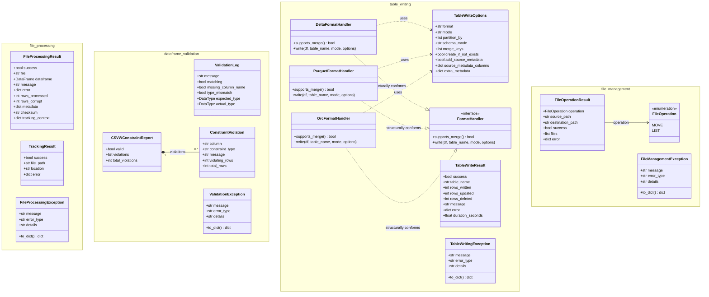
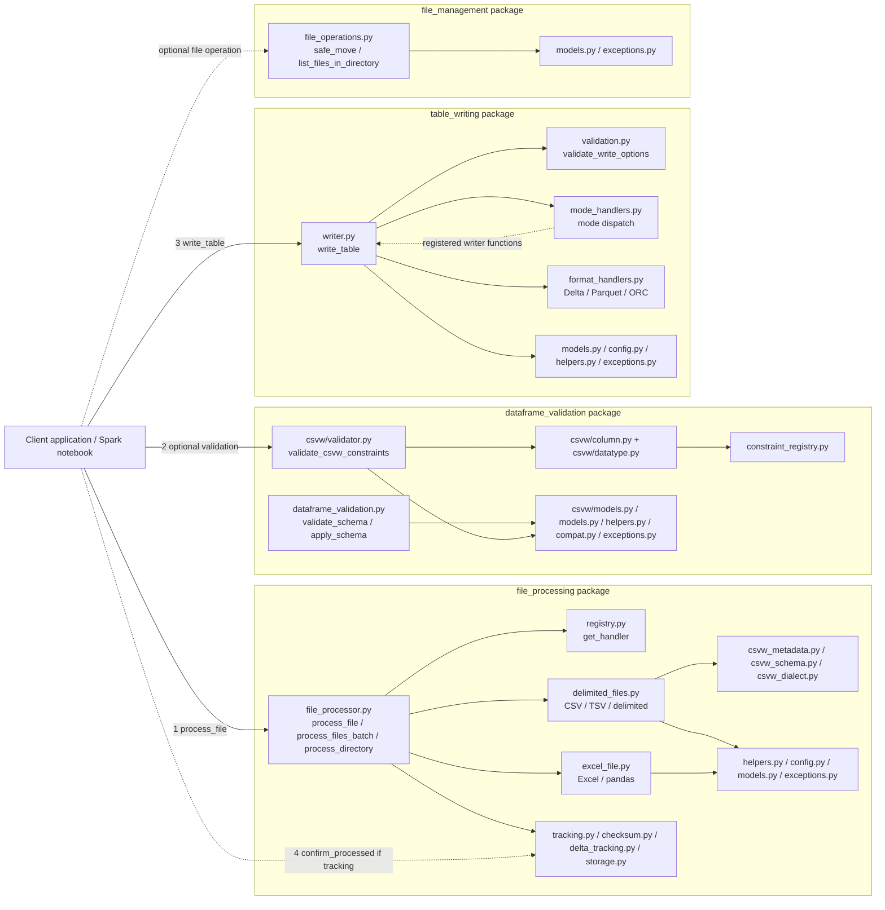
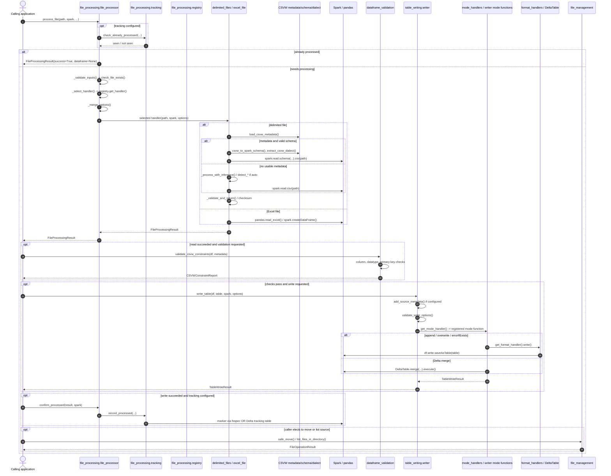

# SIFFT — Python library architecture and function call map

Source: https://github.com/dvla/sifft, branch `main`; inspected 12 October 2026. Package version reported by `pyproject.toml`: **0.9.3**.

## Key architectural point

The caller orchestrates the pipeline; this is a four-package library, **not** an engine that automatically chains read → CSVW constraint validation → write → move. `process_file()` reads and returns a result; `validate_csvw_constraints()` and `write_table()` are invoked separately by the calling application. `confirm_processed()` must be called after downstream success if deferred tracking is used.

## 1. UML class diagram (all identified library classes)

`FormatHandler` is a typing `Protocol`; the concrete handlers conform **structurally**, without explicit Python subclass inheritance.

## 2. Module-level dependency diagram

Each package additionally has its own `__init__.py` that re-exports its public functions and types. The `dataframe_validation/csvw` directory also has `__init__.py`.

### Full source module inventory (excluding tests, docs, and samples)

- `file_processing/` (16): `__init__.py`, `file_processor.py`, `delimited_files.py`, `excel_file.py`, `csvw_metadata.py`, `csvw_schema.py`, `csvw_dialect.py`, `registry.py`, `tracking.py`, `checksum.py`, `delta_tracking.py`, `storage.py`, `helpers.py`, `models.py`, `config.py`, `exceptions.py`.
- `dataframe_validation/` (12): `__init__.py`, `dataframe_validation.py`, `constraint_registry.py`, `compat.py`, `helpers.py`, `models.py`, `exceptions.py`, `csvw/__init__.py`, `csvw/validator.py`, `csvw/column.py`, `csvw/datatype.py`, `csvw/models.py`.
- `table_writing/` (9): `__init__.py`, `writer.py`, `validation.py`, `mode_handlers.py`, `format_handlers.py`, `models.py`, `helpers.py`, `config.py`, `exceptions.py`.
- `file_management/` (4): `__init__.py`, `file_operations.py`, `models.py`, `exceptions.py`.

## 3. Execution sequence for a complete ingestion

## 4. Function-by-function order

1. **Caller → `file_processing.file_processor.process_file(path, spark, ...)`:** if tracking is configured, it first calls `tracking.check_already_processed`, which delegates to the marker-file (`checksum.is_file_processed`) or Delta (`delta_tracking.is_file_processed_delta`) implementation. An already-seen file returns a successful skip result, **but its `dataframe` is `None`**.
2. **`process_file` → `_validate_inputs` → `helpers.check_file_exists`:** verifies Spark exists, source path is a local `Path`-accessible nonempty file. The current implementation's local `Path` check is worth noting if using remote cloud URIs.
3. **`process_file` → `_select_handler` → `registry.get_handler`:** custom handlers take priority. Then `.xls/.xlsx` choose `_process_excel_file`, recognized delimited extensions choose `_process_delimited_file`, and unknown/no extensions fall back to delimited parsing.
4. **`process_file` → `_merge_options` → selected handler:** defaults are merged with user settings, then storage and explicit CSVW paths are added.
5. **Delimited branch → `_process_delimited_file` → `csvw_metadata.load_csvw_metadata`:** metadata can be discovered as `<stem>.csv-metadata.json`, `<stem>-metadata.json`, or `metadata.json`, or explicitly provided.
6. **Delimited CSVW branch:** `_process_with_csvw` calls `csvw_schema.csvw_to_spark_schema` (which calls `csvw_metadata.get_table_schema`, `_convert_column_to_field`, `_map_csvw_type_to_spark`), `csvw_dialect.extract_csvw_dialect`, and `extract_csvw_null_values`. It configures `spark.read.schema(...).csv(...)`, then `_validate_and_return`, `compute_file_checksum`.
7. **Delimited inference branch:** `_process_with_inference` optionally calls `helpers.detect_delimiter` / `detect_header` only when the corresponding option is `'auto'`, then `spark.read.csv`, `_validate_and_return`, `compute_file_checksum`. `_validate_and_return` counts records, detects corrupt rows, and returns `FileProcessingResult`.
8. **Excel branch:** `_process_excel_file` checks file size, calls `pandas.read_excel`, then `spark.createDataFrame`, and returns `FileProcessingResult`.
9. **Optional schema checks:** caller invokes `dataframe_validation.validate_schema(df, expected_schema)` (returns `dict[str, ValidationLog]`) and optionally `apply_schema` (uses `compat.safe_cast`), as separate API calls.
10. **Optional CSVW checks:** caller invokes `dataframe_validation.validate_csvw_constraints(df, result.metadata)`. In `csvw/validator.py` it calls `_get_table_schema`, iterates columns, calls `_validate_column_constraints` (batched/individual including custom `constraint_registry.get_constraint_validator`) and `_validate_datatype_constraints`, then `_validate_primary_key`, and returns `CSVWConstraintReport` containing `ConstraintViolation` entries.
11. **Caller → `table_writing.writer.write_table(df, table_name, spark, options)`:** creates default `TableWriteOptions` if absent, optionally calls `helpers.add_source_metadata`, then calls `validation.validate_write_options`.
12. **Pre-write validation order:** `_validate_inputs`, `_validate_dataframe_not_empty`, `_validate_format`, `_validate_mode`, `_validate_merge_keys`, `_validate_partitions`, `_validate_table_exists`, `_validate_schema_mode`.
13. **Mode dispatch:** `mode_handlers.get_mode_handler(options.mode)` selects `_write_append`, `_write_overwrite`, `_write_error_if_exists`, or `_write_merge` registered in `writer.py` at import time. The first three use `format_handlers.get_format_handler` and `.write(...)` from a `DeltaFormatHandler`, `ParquetFormatHandler`, or `OrcFormatHandler`, eventually `df.write.saveAsTable`. Merge uses `DeltaTable.forName(...).merge(...).execute()`; if table is missing and creation is allowed it calls `_write_append`.
14. **Write result:** the mode handler returns `TableWriteResult` and `write_table` adds duration.
15. **Optional deferred confirmation:** after verifying successful validation and write, caller calls `file_processing.confirm_processed(result, spark)`. This calls `tracking.record_processed`, dispatching to `checksum.mark_file_processed` (marker via fsspec) or `delta_tracking.mark_file_processed_delta` (Delta tracking table). It is **not automatically invoked** by `process_file` or `write_table`.
16. **Optional file management:** caller separately calls `file_management.file_operations.safe_move` or `list_files_in_directory`, which use fsspec and return `FileOperationResult`.

`process_files_batch` and `process_directory` are wrappers: they loop over files, call `process_file`, collect results, and optionally raise an aggregate error. They do not automatically validate CSVW constraints or write tables.

### Notes

- For known extensions, delimiter defaults are configured (`.csv` comma, `.tsv` tab, `.dat` pipe); auto-detection is active when the option is explicitly set to `'auto'`, or through fallback defaults for unknown/no extension.
- CSVW metadata may influence **parsing schema and dialect**, but the **CSVW constraint checker is a separate call**.
- `process_file` can return `success=True` for a previously processed file with `dataframe=None`; check both `result.success` and `result.dataframe is not None` before validation/writing.
- `count()`, `collect()`, `saveAsTable()` and Delta merge execution can trigger Spark jobs; ingestion is not one atomic transaction spanning all four packages.
- The source code is the authority for tracking semantics; the documentation's older `process_file` tracking example does not show the required deferred `confirm_processed` call.

### Sources

- https://raw.githubusercontent.com/dvla/sifft/main/file_processing/file_processor.py
- https://raw.githubusercontent.com/dvla/sifft/main/file_processing/delimited_files.py
- https://raw.githubusercontent.com/dvla/sifft/main/dataframe_validation/csvw/validator.py
- https://raw.githubusercontent.com/dvla/sifft/main/table_writing/writer.py
- https://raw.githubusercontent.com/dvla/sifft/main/table_writing/format_handlers.py
- https://raw.githubusercontent.com/dvla/sifft/main/file_management/file_operations.py
- https://raw.githubusercontent.com/dvla/sifft/main/pyproject.toml
